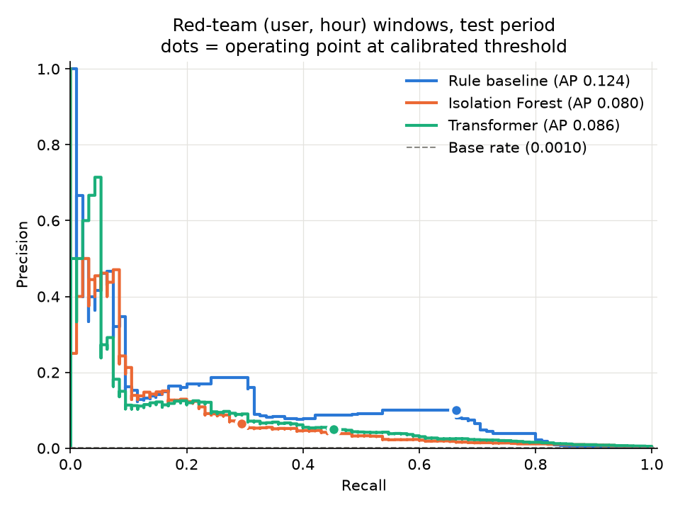

# Behavioral Threat Detection on Auth Logs

Attackers with stolen credentials move between hosts using logons that look normal one
at a time. This project learns each user's normal login behaviour from the real LANL
2015 enterprise logs and flags deviations with three detectors: simple rules (also
written as 8 Microsoft Sentinel KQL queries), an Isolation Forest, and a small
Transformer. On 6.9M real events the simple rules ranked attacks best, and every alert
comes with its reasons and MITRE ATT&CK techniques.

> Defensive project only: it reads log files and writes scores, plots and alerts. No
> malware, exploit code or executables.

## How it works

1. **Data:** `prepare_data.py` takes the first 10 days of LANL auth logs (or generates a
   synthetic log with the same columns) and labels the red-team logons.
2. **Features:** `features.py` computes per-user signals such as first-ever user→host
   pair, new source host and unusual hour, counted per user per hour.
3. **Detectors:**
   - Rules: `baseline_rules.py`, the same logic as `detections/*.kql`.
   - Isolation Forest: `model_iforest.py`.
   - Transformer: `model_transformer.py` predicts each user's next logon; a surprising
     logon is suspicious.
4. **Evaluation:** `evaluate.py` sets each threshold on a normal day (0.5% alert budget)
   *before* looking at the test week. It reports precision, recall, alerts per day, PR
   curves and 95% bootstrap intervals, and writes explained alerts to `alerts.jsonl`.

## Results (real LANL data)

Test: 7 days, 93,255 user-hours, 95 of them containing red-team activity (0.1%).
Full table: `results/lanl/comparison.md`.

| Model | Precision | Recall | Alerts/day | PR-AUC (95% CI) |
|---|---|---|---|---|
| Rule baseline | 0.0995 | 0.6632 | 90.4 | 0.1239 (0.080–0.203) |
| Isolation Forest | 0.0648 | 0.2947 | 61.7 | 0.0799 (0.042–0.153) |
| Transformer | 0.0498 | 0.4526 | 123.3 | 0.0859 (0.047–0.156) |

Over 3 training seeds the Transformer's PR-AUC is 0.073 ± 0.012 and the Isolation
Forest's is 0.084 ± 0.003 (`results/lanl/seed_variance.csv`).



**Takeaways**
- **The simple rules won.** The ML models did not beat them, though the confidence
  intervals overlap, so the ranking isn't settled.
- **The attacks are concentrated.** Almost every red-team logon comes from one host
  using NTLM, so one rule ("NTLM logon to a new host") catches it well: 66 of its 341
  alert hours are real.
- **The Transformer finds events, but scores hours poorly.** It ranks single events
  well (ROC-AUC 0.990) but loses ground when events are grouped per hour, because the
  attacked accounts are busy ones.
- **A weekend broke my first try.** Thresholds set on a weekend gave far too many
  alerts on weekdays, so calibration now uses a weekday.
- **Synthetic results did not transfer.** On my own synthetic data the Transformer won
  clearly (PR-AUC 0.847 vs 0.644 for the rules, `results/synthetic/`). That gap is the
  main lesson.

## Setup and run

Python 3.10+, CPU only.

```bash
python3 -m venv .venv
source .venv/bin/activate
python -m pip install --upgrade pip
pip install -r requirements.txt
pip freeze > requirements.lock

make data && make train && make eval   # synthetic data, about 1 minute
make test                              # pytest checks
make seeds                             # seed variance
```

Real LANL data needs the free download links from the
[LANL dataset page](https://csr.lanl.gov/data/cyber1/):

```bash
make data-lanl AUTH="<auth.txt.gz link>" REDTEAM="<redteam.txt.gz link>"
make train && make eval
```

## KQL detections

`detections/` has 8 KQL queries for Microsoft Sentinel (`SecurityEvent` 4624/4625 and
`SigninLogs`). Together they cover 5 ATT&CK techniques:

| Technique | What it covers |
|---|---|
| T1021 | Remote Services |
| T1021.001 | RDP |
| T1078 | Valid Accounts |
| T1110 | Brute Force |
| T1550.002 | Pass the Hash |

They were checked locally through identical pandas logic, **not** in a live Sentinel
workspace.

## Limitations

- **Few positives:** 95 positive hours, almost all from one attacker host.
- **Sampled data:** 10% of users and 10 of the 58 days.
- **Split changed once:** the train/calibration split was changed once after a first
  run (the weekend issue).
- **Synthetic tuning:** the Transformer's hourly scoring was chosen on synthetic data.
- **Untested in Sentinel:** the KQL was not run in Sentinel.

## Credits

- **Data:** LANL 2015 Comprehensive Multi-Source Cyber-Security Events, A. D. Kent,
  [doi:10.17021/1179829](http://dx.doi.org/10.17021/1179829).
- **Ideas (no code copied):**
  - [Euler](https://github.com/iHeartGraph/Euler): lateral-movement detection on LANL.
  - [safekit](https://github.com/pnnl/safekit): log events as sentences.
- **Libraries:** PyTorch, scikit-learn, SHAP, pandas, NumPy, PyArrow, matplotlib,
  pytest.

Everything else here was written for this project. MIT license.
